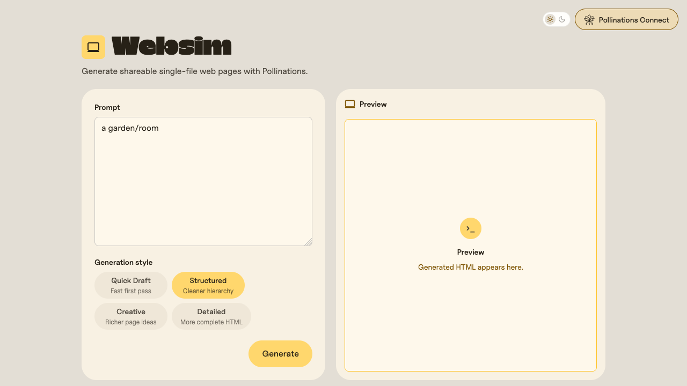

# Websim

[](https://pollinations.ai/?ref=badge)

Generate, preview and save single-file HTML pages using your own Pollinations Pollen.
The browser uses the published `@pollinations/sdk` and `@pollinations/ui` packages;
there are no local package links, monorepo imports or app-specific backend.

## Local development

Use Node.js 24:

```sh
npm ci
npm run dev
```

Open `http://localhost:16386/`. Use `localhost` for the registered login callback.
`npm run typecheck`, `npm test` and `npm run build` check the app. `npm run preview`
serves the production build on the same port. With an existing API key supplied
securely as `POLLINATIONS_API_KEY`, `npm run test:live` checks real generation
through the published SDK for every model choice; it consumes Pollen.

For browser checks, install Chromium with `npx playwright install chromium`,
start `npm run preview`, and run `npm run test:browser` with the same securely
supplied test key. This checks real generation, cancellation, legacy links,
PKCE requests, Save/Open isolation, mobile layout and disconnect. It also saves
an unauthenticated catalog screenshot to `screenshots/websim.png`.



## Login and generated pages

The published SDK handles PKCE sign-in using public app key
`pk_wYCqFfSdCXZL8UBW`. User keys stay in session storage; generation calls the
Pollinations API directly with the signed-in user's key. The account menu shows
Pollen and permissions and lets users disconnect.

Legacy `/{prompt}/?model=...` browser links now open the app with that prompt
and an allowed model selected. They normalize to the root callback before login;
nothing generates until the user chooses Generate. The static app does not serve
the old `/api/generate`, `/api/health` or bearer-authenticated raw HTML endpoints.
Machine clients should call the published Pollinations SDK/API directly.

Both Preview and Open isolate generated scripts in a sandboxed iframe. Save
exports the generated HTML itself. The page-generation prompt uses inline
illustrations so saved pages do not require embedded API credentials.

## Publishing

The destination is `https://websim.pollinations.app`. Like any external app:

```sh
npm run build
polli sites deploy dist --name websim
```

Use the published CLI included in this repository (`npm run deploy` does both).
The owning account is `polli@pollinations.ai`; Sites requires `account:machines`.
No Cloudflare credential is needed by the app's final deployment workflow.

**Deploy / Pollinations production** runs from `production` in GitHub Actions,
using its environment secret `POLLINATIONS_API_KEY`. Keep `AUTO_DEPLOY` unset until
cutover is verified; then enable it for pushes to `production`. Promote `main`
to `production` through a PR. Never put the deployment key in Vite/browser config.

The Sites cutover is still pending. Preserve the current Worker until the Site,
login callback, generation, prompt links and assets are verified. The exact
Cloudflare route currently serving `websim.pollinations.app/*` must be handed
back to Sites, and `.ai` should redirect with paths/query strings preserved.
Check remaining raw API clients before retiring the old Worker. Rollback restores
the old route and disables the Sites workflow; retain the old Worker for this.

## Catalog submission

Hosting and the community catalog are separate. Submit the working public URL,
this repository, a real screenshot, category `build`, platform `web` and language
`en` through the normal [app-submission form](https://github.com/pollinations/pollinations/issues/new?template=app-submission.yml). The README badge above supplies the
required credit. Review and approval are still required for a catalog listing.

## Source and attribution

Extracted from [Pollinations Websim](https://github.com/pollinations/pollinations/tree/daa3b5910521060efb43194677e172044d514097/apps/websim).
Git history preserves the original authors and earlier directory names. See [LICENSE](LICENSE).
